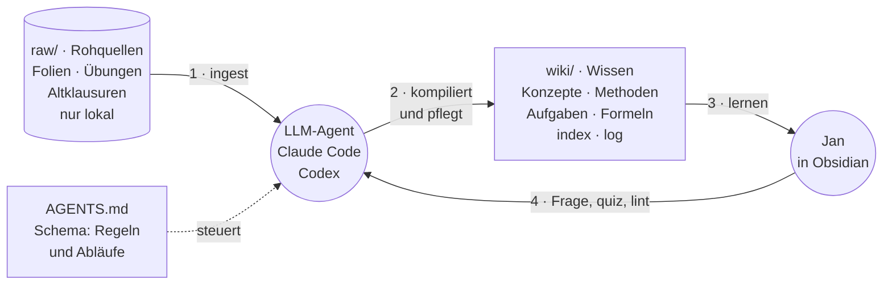

# LLM-Wiki für Data Science & Statistik

Ein Obsidian-Vault nach dem [LLM-Wiki-Muster von Andrej Karpathy](https://gist.github.com/karpathy/442a6bf555914893e9891c11519de94f), aufgebaut für die Statistik-Klausur am **13.11.2026** im M.Eng. *Intelligent Analytics & Data Science* (FH Kufstein Tirol).

Statt bei jeder Frage Folien neu zu durchsuchen (RAG), kompiliert ein LLM-Agent die Quellen **einmal** in ein querverlinktes Wiki und hält es danach aktuell. Jede neue Quelle und jede gute Frage macht das Wiki reicher.

> Obsidian ist die IDE, der Agent ist der Programmierer, das Wiki ist die Codebasis.

## Aufbau

```
AGENTS.md       Schema: Konventionen und Workflows für den Agenten (Claude Code, Codex, …)
CLAUDE.md       Verweis auf AGENTS.md für Claude Code
raw/            Rohquellen – nur lokal, per .gitignore ausgeschlossen
wiki/           Vom Agenten gepflegte Seiten
  index.md        Katalog aller Seiten
  log.md          Chronologisches Protokoll
  overview.md     Klausur, Themenkarte, Lernplan
  dashboard.md    Countdown und Lernfortschritt (Dataview)
  formelsammlung.md
  quellen/ konzepte/ methoden/ aufgaben/ vergleiche/ lernen/
notebooks/      Jupyter-Notebooks zu den Methoden
templates/      Seitenvorlagen
```

## Einrichtung

1. Repo klonen und den Ordner in Obsidian als Vault öffnen.
2. Community-Plugins installieren:
   - **Dataview** – in den Einstellungen *Enable JavaScript Queries* aktivieren (für den Countdown im Dashboard)
   - **Spaced Repetition** – Karteikarten aus den Wiki-Seiten (Tag `#flashcards/statistik`)
   - **Obsidian Git** nicht nötig – der Agent committet und pusht nach jeder Operation selbst
3. Vorlesungsunterlagen nach `raw/vorlesung/`, Übungen nach `raw/uebungen/`, Altklausuren nach `raw/altklausuren/` legen.
4. Agent im Vault-Ordner starten (z. B. `claude` oder `codex`), Obsidian daneben öffnen.

## Arbeitsweise

| Befehl an den Agenten | Was passiert |
|---|---|
| `ingest raw/vorlesung/vl01-….pdf` | Quelle lesen, Quellenseite schreiben, Konzept- und Methodenseiten anlegen oder ergänzen, Formelsammlung, Index und Log aktualisieren |
| Frage zum Stoff | Antwort aus dem Wiki mit Links; gute Antworten werden als neue Seite abgelegt |
| `quiz <thema>` | Prüfungsfragen im Klausurstil, danach Beherrschungsgrad und Schwachstellen aktualisieren |
| `lint` | Gesundheitscheck: Widersprüche, verwaiste Seiten, fehlende Querverweise, Lücken gegenüber Altklausuren |

Details stehen in [AGENTS.md](AGENTS.md).

## Lernen

Die Klausur ist ohne Hilfsmittel. Deshalb aktiv lernen: selbst rechnen und aus dem Kopf abrufen statt nur lesen. Welche Themen wann dran sind, steht im Lernplan in [`wiki/overview.md`](wiki/overview.md). Den Stand zeigt `wiki/dashboard.md`.

Eine Lernsitzung (ca. 90 Min.):

1. **Lesen in Obsidian:** die Konzept- und Methodenseiten des Themas (Strg+O, Seitenname tippen). Formeln in der Leseansicht ansehen (Strg+E), Links mit Strg+Klick in einem neuen Tab öffnen.
2. **Auf Papier nachrechnen:** Herleitungen wie die Normalgleichung selbst durchführen.
3. **Aufgaben rechnen:** In `wiki/aufgaben/` vorher „Lösungsweg“ und „Ergebnis“ zuklappen (Pfeil links neben der Überschrift), auf Papier lösen, dann vergleichen.
4. **Karteikarten:** Strg+P → „Spaced Repetition: Review flashcards in this note“ auf den gerade gelernten Seiten.
5. **Quiz im Terminal:** `quiz <thema>` an den Agenten, z. B. `quiz glm`. Er stellt eine Frage nach der anderen und löst erst nach der Antwort auf. Danach passt er `beherrschung` an, trägt Fehler in `wiki/lernen/schwachstellen.md` ein, schreibt das Log und committet und pusht.

Täglich etwa 10 Minuten fällige Karteikarten: Strg+P → „Spaced Repetition: Review flashcards from all notes“.

## Hinweis zu Quellen

Vorlesungsfolien, Übungsblätter und Altklausuren unterliegen dem Urheberrecht der Lehrenden und werden deshalb **nicht** versioniert. Das Wiki enthält eigene Zusammenfassungen mit Quellenangaben.

## Lizenz

MIT für die eigenen Inhalte, siehe [LICENSE](LICENSE).

## Das Konzept: LLM-Wiki

Die Idee stammt von [Andrej Karpathy](https://gist.github.com/karpathy/442a6bf555914893e9891c11519de94f). Der übliche Weg, ein LLM mit eigenen Unterlagen zu nutzen, ist RAG: Bei jeder Frage sucht das Modell passende Stellen in den Rohdokumenten und setzt daraus eine Antwort zusammen. Das Wissen wird jedes Mal neu aufbereitet und verschwindet danach im Chatverlauf.

Ein LLM-Wiki dreht das um. Der Agent liest jede Quelle **einmal** gründlich und kompiliert sie in ein dauerhaftes, querverlinktes Markdown-Wiki. Fragen, Quiz-Ergebnisse und neue Quellen ergänzen dieses Wiki, statt verloren zu gehen. Das Wissen sammelt sich an.



Der Kreislauf: Quellen werden einmal eingelesen (1) und ins Wiki kompiliert (2). Jan lernt im Wiki (3) und stellt Fragen oder lässt sich abfragen (4). Der Agent liest dafür zuerst `index.md`, antwortet aus dem Wiki und legt gute Antworten und Quiz-Ergebnisse wieder dort ab. So wird das Wiki mit jeder Runde vollständiger.

**Drei Schichten**

| Schicht | Inhalt | Wer schreibt |
|---|---|---|
| `raw/` | Rohquellen: Folien, Übungen, Altklausuren. Unveränderlich, nur lokal. | Jan legt ab, der Agent liest nur |
| `wiki/` | Kompiliertes Wissen: Seiten mit Belegen, Formelsammlung, Index, Log | nur der Agent |
| `AGENTS.md` | Schema: Seitenformat, Konventionen, Abläufe | Jan und Agent gemeinsam |

**RAG und LLM-Wiki im Vergleich**

| | RAG | LLM-Wiki |
|---|---|---|
| Wann wird Wissen aufbereitet? | bei jeder Frage neu | einmal beim Ingest, danach gepflegt |
| Wo landet eine gute Antwort? | im Chatverlauf | als Seite im Wiki |
| Widersprüche zwischen Quellen | fallen kaum auf | werden beim Ingest und Lint markiert |
| Nachprüfbarkeit | schwer | jede Aussage mit Quelle und Folie belegt |
| Für Menschen lesbar | kaum | ja, in Obsidian mit Links und Graph |
